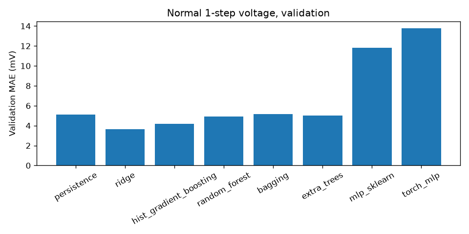
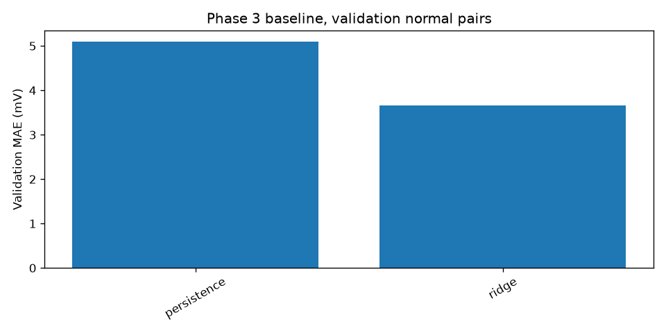
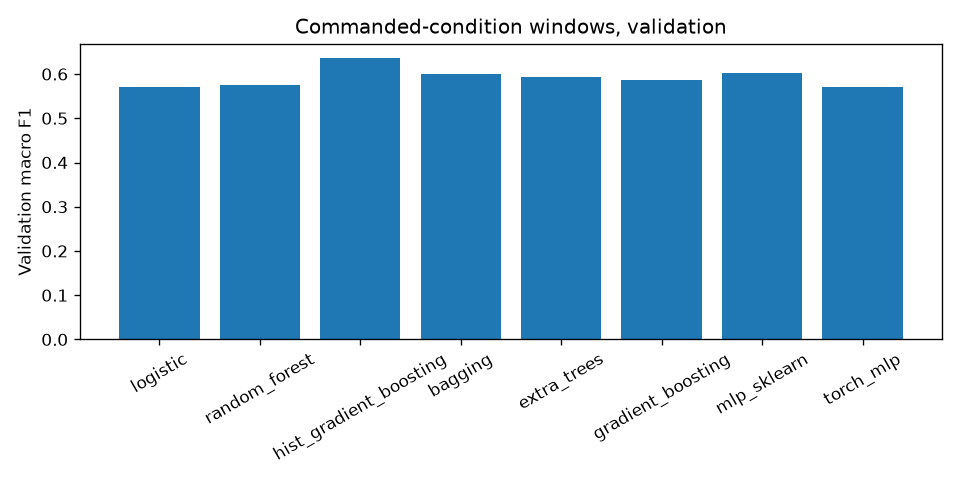
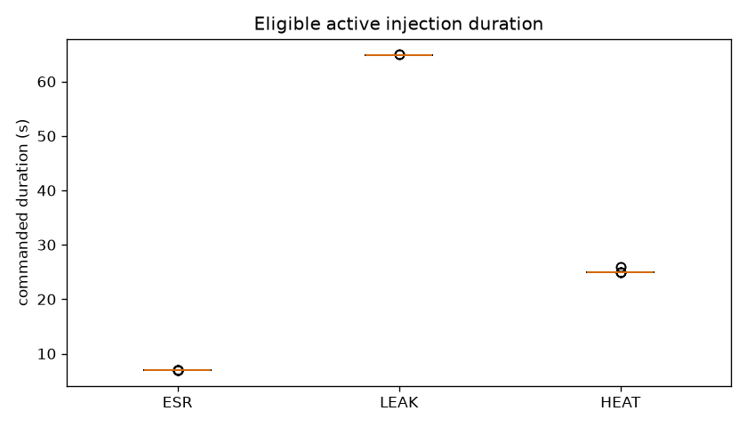

# 모델 성능 비교

수치는 실측 Phase 4~5 결과 파일이며, 이 저장소에서 다시 계산하지 않았다. 라벨은 명령된 실험 조건이다. `physical_fault_verified`가 참인 행은 없다.

정의:

- 전압 MAE, RMSE, R²: 정상 1초 쌍. 예측은 이전 샘플만 사용하고, 정답은 다음 샘플의 셀 전압 4개다. 검증으로 모델을 고른 뒤 테스트는 한 번 계산했다.
- 검출기 onset: 이벤트 시작 직전에 경보가 꺼져 있고, 이벤트 구간과 grace 20초 안에 경보가 켜진 경우만 성공이다. 이미 켜져 있던 경보는 성공이 아니다.
- 분류 매크로 F1: 30초 창의 NORMAL/ESR/LEAK/HEAT. 창 끝의 명령 라벨이 정답이다. Accuracy만으로 고르지 않았다.
- 부하 ESR: 이미 짝을 맞춘 휴지 전압과 부하 전압의 셀별 초과 강하 z-score. 옴 단위 저항이 아니다.

## 1초 전압, 검증 MAE

출처: `results/regression_metrics.csv`.

| 모델 | 검증 쌍 | 검증 MAE (V) | 선정 |
|---|---:|---:|---|
| ridge | 5783 | 0.0036587928360879915 | 예 |
| hist_gradient_boosting | 5783 | 0.004176920236262125 | 아니오 |
| random_forest | 5783 | 0.004893429450518062 | 아니오 |
| extra_trees | 5783 | 0.00501031875687114 | 아니오 |
| persistence | 5783 | 0.005098435068303566 | 아니오 |
| bagging | 5783 | 0.005177281814887486 | 아니오 |
| mlp_sklearn | 5783 | 0.011838530718169591 | 아니오 |
| torch_mlp | 5783 | 0.013790949693311415 | 아니오 |

테스트에서 선정된 Ridge MAE는 0.004108472472556147 V, RMSE 0.005987774501881316 V, R² 0.9982278115528822, 정상 쌍 10331개다. R²가 높은 이유는 1초 뒤 전압이 현재 전압과 가깝기 때문이다. 전체 테스트 표는 `results/model_comparison.csv`다.

## 잔차·온도 경보

검증에서 정상 onset이 더 적은 후보를 먼저 고르고, 그다음 명령 HEAT onset, 그다음 LEAK onset을 보았다. MAE로 고르지 않았다.

선정: persistence, 온도 rise, alpha 0.2, 전압 분위수 0.999. 전압 임계 0.025206015466180683 V, 온도 임계 0.7 °C.

테스트 (`results/event_detection_comparison.csv`):

| 조건 | 이벤트 | onset recall | 평균 지연 | 셀 일치 | 정상 onset |
|---|---:|---:|---:|---:|---:|
| ESR | 19 | 0.1052631578947368 (2/19) | 2.995903968811035 s | 1.0 | 1 |
| LEAK | 10 | 0.0 (0/10) |  |  | 1 |
| HEAT | 17 | 0.5294117647058824 (9/17) | 17.202529774771797 s | 1.0 | 1 |

정상 onset 1회는 테스트 정상 시간 4.26051481280062시간에 대한 값이다.

## 명령 조건 분류

검증 매크로 F1이 가장 높은 모델은 hist_gradient_boosting이다. 창 30초, 가중치 sqrt. 검증 매크로 F1 0.6369627307090966. 테스트 매크로 F1 0.7575336905637502, 정상 창을 고장으로 본 비율 0.008643753858818687.

테스트 창 단위 recall (`results/classification_comparison.csv`, support):

| 클래스 | precision | recall | F1 | support |
|---|---:|---:|---:|---:|
| NORMAL | 0.9842664487127094 | 0.9913562461411813 | 0.9877986260637752 | 9718 |
| ESR | 0.6428571428571429 | 0.5921052631578947 | 0.6164383561643836 | 152 |
| LEAK | 0.9228915662650602 | 0.5803030303030303 | 0.7125581395348837 | 660 |
| HEAT | 0.6061093247588425 | 0.8666666666666667 | 0.7133396404919584 | 435 |

이벤트 onset (이미 켜져 있던 경보 제외):

| 조건 | onset | 셀 일치 | 평균 지연 |
|---|---:|---:|---:|
| ESR | 16/19 | 0.375 | 1.997774571180344 s |
| LEAK | 8/10 | 0.75 | 14.735111236572266 s |
| HEAT | 17/17 | 0.4117647058823529 | 2.7031579157885384 s |

이 분류기의 가중치는 저장되지 않았다. 로지스틱 참고 모델의 테스트 매크로 F1은 0.6156686788758896이며 선정 점수가 아니다.

## Autoencoder

테스트 AUROC 0.4946321057345614, PR-AUC 0.26279260444494035, 정상 창 경보율 0.006174109899156205. 창 recall ESR 0.17105263157894737, LEAK 0.0, HEAT 0.3931034482758621. 임계값 0.1745047409821838. 가중치는 없다.

## 부하 강하 ESR

테스트 이벤트 19/19, 셀 일치 1.0, 정상 부하 오경보 0/169. 임계값 3.4429849433264446. 검증 정상 최대값에 1e-6을 더한 값이라 검증 오경보는 구성상 0이다.

## 선행 실험

`results/previous_experiment_comparison.csv`의 선행 수치는 `2026-11-11_measured.md` 실험이다. 평가 코드가 다르므로 이번 결과와의 차이를 개선율로 쓰지 않는다.

